# DhruvAR high-level and low-level design

Written from the code on `main` as of 4 November 2026. This describes the Android planner, the AR view, the dashboard API, and the web app as they are built. Diagrams live in `docs/design/figures/`.

DhruvAR is a field-planning prototype. An operator draws a region on a map, places vehicles and aircraft at metric sizes, saves that plan on the phone, and can project the same plan onto a detected ground plane with ARCore. A reviewer can later open the same plan in a browser and approve it, reject it, or ask for changes.

The saved layout is the contract. The map, the AR scene, and the dashboard are three views of that one record.

---

## 1. High-level design

### 1.1 What the system is for

The operator's job is to produce a layout: a named plan with a geographic box, one origin, and zero or more placed assets. Positions are metres from that origin. The phone keeps the file even when the network is down.

Sending a plan is optional. Sign-in, the dashboard, and the map-tile server can all be absent and the operator can still plan, save, and open AR.

The system is a visualization and review prototype. It records the GNSS accuracy that came with a fix. It does not claim survey-grade positions.

### 1.2 System context

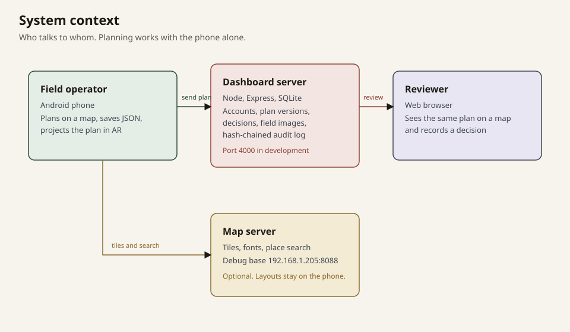

Four parties:

| Party | Role in the design |
|---|---|
| Field operator, Android phone | Creates and stores the layout. Optionally sends it. |
| Dashboard server | Accounts, versions, decisions, photos, audit log. |
| Reviewer, browser | Reads the plan on a map and records a decision. |
| Map server | Tiles, fonts, and place search. Display only. |

The phone talks to the map server while the operator is searching or panning. It talks to the dashboard server only for sign-in, send, resubmit, and status refresh. The reviewer's browser talks to the dashboard server. If a basemap URL is configured, the browser may also load tiles.

Development addresses baked into the debug build:

- Map server: `http://192.168.1.205:8088`
- Dashboard: `http://192.168.1.214:4000`

Release builds leave the dashboard URL blank and accept only `https://` addresses. If the map-server base is empty, the phone uses a public MapLibre style and place search is off.

### 1.3 Design principles

1. **One layout, many views.** Map symbols, AR meshes, and dashboard footprints are drawn from the same metres, sizes, and heading.
2. **The phone is complete by itself.** Account state is a separate view model. Planning and AR do not wait on it.
3. **The server is the authority for decisions.** The web app hides buttons the role cannot use. The API checks the role again and answers 404 for a plan the caller may not see.
4. **Versions are immutable.** A decision names a version and a content hash. A newer upload does not rewrite the version that was decided.
5. **Pixels are a display detail.** Hit testing on the map converts the finger into metres before anything is stored.

### 1.4 Android application, high level


`MainActivity` hosts Jetpack Compose. `AppNavigation` owns one `PlanningViewModel` and one `AccountViewModel` for the whole graph, so opening AR does not create a second copy of the plan.

Screens:

| Screen | Job |
|---|---|
| Home | List saved plans, start a new one, send for approval, open the field guide or sign-in. |
| Sign in | Dashboard URL, username, and password. |
| Planning | Guided setup, then the map workspace. |
| AR visualization | Ground plane, session origin, GLB models. |
| Field guide | Static instructions. No plan data. |

There is no dependency-injection framework. View models are Android `ViewModel`s. Domain types are plain Kotlin.

### 1.5 Operator journey

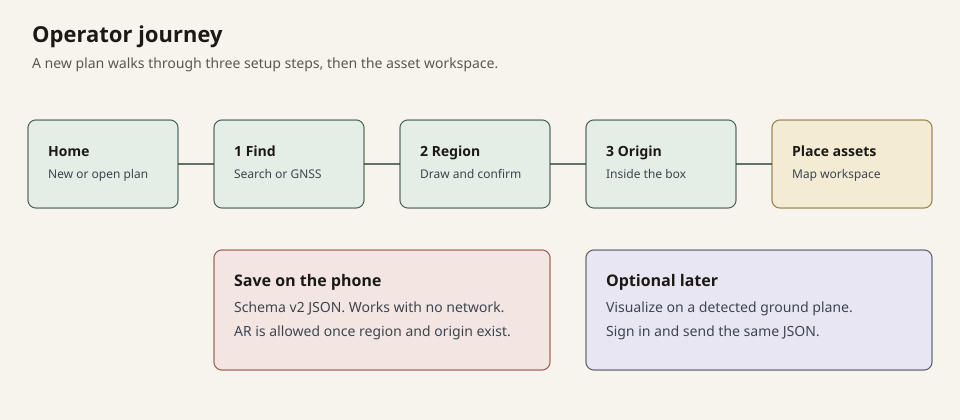

A new plan is a short sequence on one MapLibre map:

1. **Find location.** Search a place, or detect the phone's GNSS position, and centre the map.
2. **Set region.** Drag a box and confirm it. The box becomes `regionBounds`.
3. **Set origin.** The origin starts at the centre of that box. The operator may tap another point inside the box, stamp GNSS, and capture a compass heading.
4. **Place assets.** Add, drag, rotate, and resize the six library types. Save writes the JSON file.

AR opens from the workspace once the region and the origin exist. The asset count may be zero.

Opening an existing plan that already has a region and an origin skips the three steps and lands on the workspace.

### 1.6 Plan lifecycle

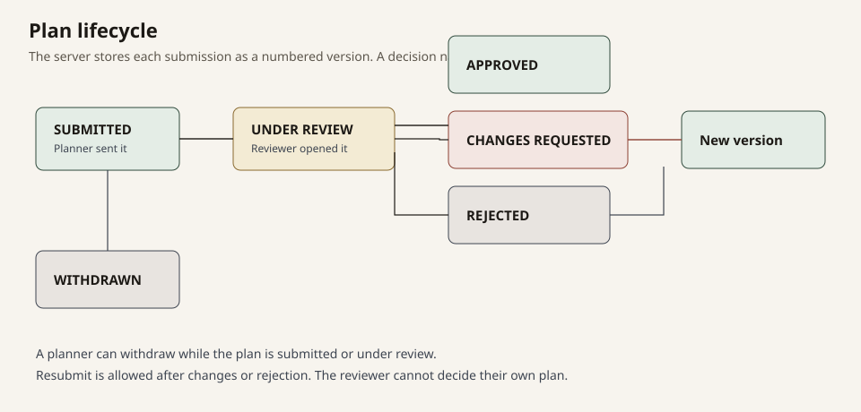

The phone's local file has no approval status. Status exists only after a send.

| Status | Meaning |
|---|---|
| SUBMITTED | A planner uploaded a version. |
| UNDER_REVIEW | A reviewer has started work. |
| APPROVED | Accepted. This version stands. |
| CHANGES_REQUESTED | The planner may upload another version. |
| REJECTED | The planner may upload another version. |
| WITHDRAWN | The planner pulled it back while it was still open. |

"Open" means submitted or under review. Withdraw is allowed only then. Resubmit is allowed only after changes or rejection. A reviewer cannot decide a plan they own.

Each upload is a new row in `plan_versions`. The decision row stores the version number. Deciding an older version after a newer one exists is refused.

### 1.7 Roles

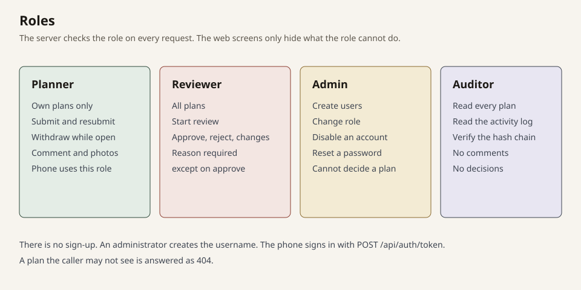

| Role | May |
|---|---|
| Planner | See only their own plans. Submit, comment, attach field photos, withdraw, resubmit. The Android account is a planner. |
| Reviewer | See every plan. Start review. Approve, reject, or request changes. Comment and attach photos. |
| Admin | See every plan. Create users, change role, disable, reset password. Cannot decide a plan. |
| Auditor | Read every plan, the activity log, and the audit-chain check. Cannot comment or decide. |

There is no public sign-up. An administrator creates the username. Everyone can change their own password.

The web app also has a demo at `/demo`. It uses the same screens with fictional data in the browser and no password. Live data is the rest of the site.

---

## 2. Features

### 2.1 Find location and GNSS

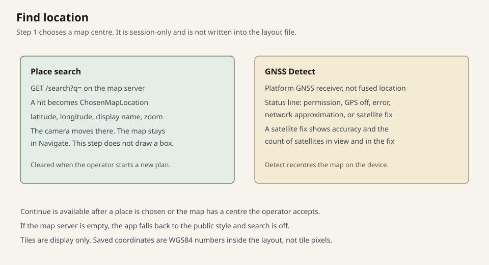

This step answers "where is the map looking?" It does not yet write the layout origin.

**Place search.** The phone calls the map server `GET /search?q=`. A chosen hit is a `ChosenMapLocation`: latitude, longitude, display name, and an optional zoom. That object lives on `PlanningSetupSession`. Starting a new plan clears it. It is never serialized into the layout JSON.

**GNSS Detect.** `PlatformGnssLocationController` reads the platform satellite receiver. The detect bar shows one line:

- location permission missing
- GPS switched off
- a receiver error
- a network position, labelled approximate, while satellites are still wanted
- a satellite fix, with horizontal accuracy and satellites in the fix versus satellites in view
- searching, with the count in view

Detect recentres the map. A network fix is shown as approximate so the operator can see it is not a satellite solution.

The map itself is MapLibre. `MAP_SERVER_BASE` points at the self-hosted India tiles. Style URLs that still say `localhost` are rewritten to that base. Tiles are a picture. The numbers that get saved are WGS84 degrees.

### 2.2 Region

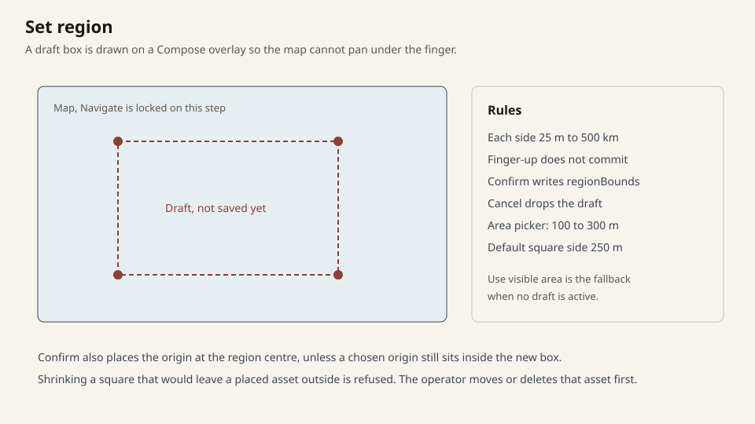

The region is the geographic box the plan is about. It is stored as four edges: north and south latitude, east and west longitude.

On this step the map mode is Select region. A Compose overlay owns the finger, so a drag draws the box and does not pan the map. Lifting the finger does not save. **Confirm** commits. **Cancel** drops the draft. "Use visible area" builds a box from the current camera when no draft is active.

`RegionDraftGeometry` rejects a box whose side is under 25 m or over 500 km.

The area picker offers squares of 100, 150, 200, 250, and 300 m. Until the operator picks one, the side is 250 m. Resizing an existing region keeps the centre. A shrink that would leave a placed asset outside the new box is refused, with the message to move or remove that asset first.

Confirm moves the setup step to asset placement. If the current origin is still inside the new box, that origin is kept. Otherwise the origin becomes the centre of the region and the assets stay on the same ground relative to it.

### 2.3 Origin and the metre frame

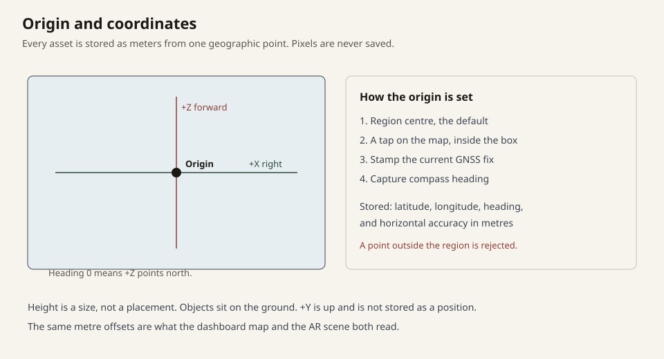

The anchor is the zero of the plan.

| Axis | Meaning |
|---|---|
| +X | Right of the origin. East when heading is 0. |
| +Z | Forward of the origin. North when heading is 0. |
| +Y | Up. Used when drawing. Not stored as a position. |
| Heading | Degrees clockwise from north to the plan's +Z. |

An object at `x = 10`, `z = -4` is 10 m to the right and 4 m behind the origin, in the plan's own heading. Rotation of an object is degrees about the vertical axis.

Ways to set the origin, all of which must land inside the region:

1. Region centre, applied when the region is confirmed and no earlier point remains inside.
2. A tap on the map, which switches the step into Set-anchor mode and then returns to Navigate.
3. Stamp the latest GNSS fix, including its horizontal accuracy.
4. Capture compass heading onto the anchor. Heading can also be cleared.

`hasGeographicFix` is true when latitude and longitude are both present and finite. Home, send, and AR all use that flag.

### 2.4 Real-size assets

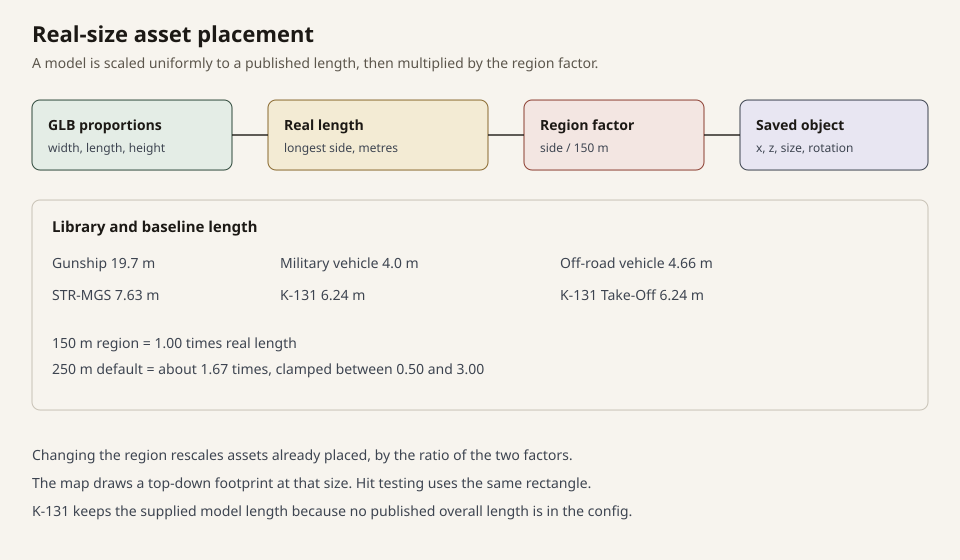

The library has six types, in three categories:

| Category | Type | Length used as the real size |
|---|---|---|
| Aircraft | Gunship | 19.7 m (average of common attack-helicopter overall lengths) |
| Vehicles | Military vehicle | 4.0 m |
| Vehicles | Off-road vehicle | 4.66 m |
| Systems | STR-MGS | 7.63 m |
| Systems | K-131 | 6.24 m, the supplied model, kept because no published length is configured |
| Systems | K-131 Take-Off | 6.24 m, same rule |

`AssetSpecification` starts from the GLB's own width, length, and height, then scales all three by the same factor so the longest horizontal side equals that real length. The model is never stretched.

**Region factor.** A 150 m region draws assets at that real length (factor 1). Other regions use `side / 150`, clamped to 0.5–3.

| Region side | Factor |
|---|---|
| 100 m | 0.67 |
| 150 m | 1.00 |
| 200 m | 1.33 |
| 250 m (default) | 1.67 |
| 300 m | 2.00 |

On the default 250 m square, a gunship is stored at about 32.8 m long, not 19.7 m. AR "Full" then shows that stored size, one planning metre to one AR metre. The enlargement is so the symbols stay readable on a larger box. Changing the region multiplies every already placed object's width, length, and height by the ratio of the new factor to the old one.

Placement writes a `LayoutObject`: type, name, `x`, `z`, rotation, and the three sizes. The map draws a top-down footprint at those sizes. Selecting an asset shows a one-line chip. The full position, rotation, and size card opens from that chip. Drag works in Navigate and Edit.

Retired types (tent, truck, car, antenna, trench) are gone from the phone. The server and the dashboard still accept them so older files and the demo keep loading.

GLB files live in `app/src/main/assets/models/`. The two K-131 files are about 57 MB each, so they dominate the APK.

### 2.5 Planning workspace

After the three steps, the screen title is Planning and the progress line disappears. Allowed map modes are Navigate, Place asset, and Edit. The asset drawer groups the catalog by Aircraft, Vehicles, and Systems, with a name filter inside the category.

The HUD is contextual: the controls on screen follow the step and the selection, rather than showing every tool at once. The theme is the light Field Kit theme on every screen.

Saving sets `updatedAtEpochMs` and writes `dhruvar_layouts/<id>.json` by writing a temporary file and renaming it. Captures from AR, when taken, go to MediaStore `Pictures/DhruvAR/` and are separate from the layout file.

### 2.6 AR visualization

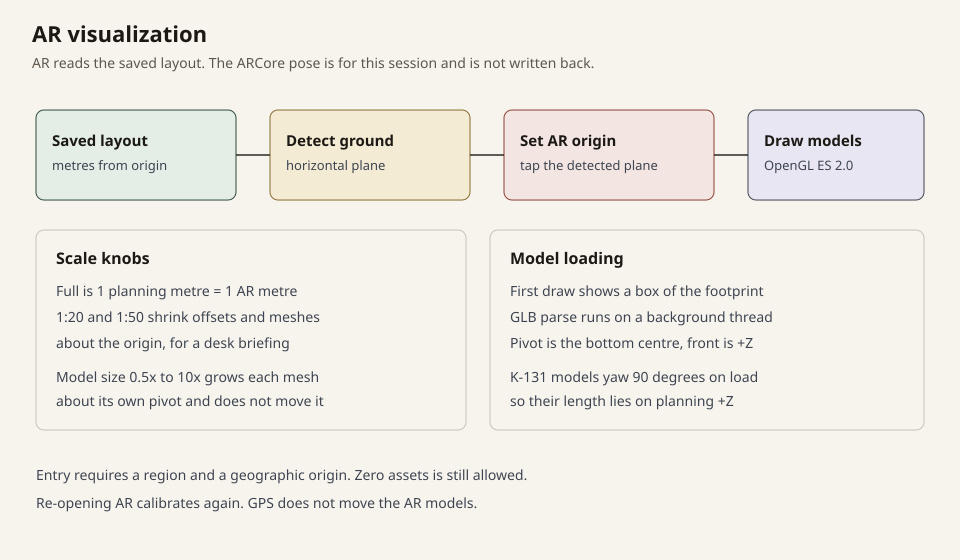

AR is a projector. It needs a region and a geographic origin. It does not edit the saved coordinates.

Sequence on the device:

1. ARCore starts and looks for a horizontal plane.
2. The operator sets a planning origin on that plane. That pose is an ARCore anchor for this session.
3. Each layout object is drawn at its `x` and `z` metres from that pose, rotated by its own degrees, with its stored width, length, and height.
4. Leaving the screen drops the ARCore anchor. Opening AR again calibrates again.

Two scale controls:

| Control | Effect |
|---|---|
| Full, 1:20, 1:50 | Scales both the offsets from the origin and the meshes. 1:20 and 1:50 are for a desk or sand-table briefing. |
| Model size, 0.5× to 10×, step 0.5, default 1 | Grows or shrinks each mesh about its own ground pivot. Positions stay put. |

GPS does not move the AR models. The geographic fields explain the plan. The AR pose explains where on the table or the ground the operator pointed.

`AssetModelRegistry` returns a box of the footprint immediately, and parses the GLB on a background thread named `asset-model-loader`. When the mesh is ready, later frames draw it. The mesh pivot is the bottom centre, front facing +Z. K-131 and K-131 Take-Off are yawed 90 degrees on load because those files run lengthwise along X.

A short geo briefing sits on the AR screen. After calibration it collapses to a chip (`Geo · Near`, `Far`, `Local`, or `No fix`) and the three-step bar is hidden.

### 2.7 Sign-in and send

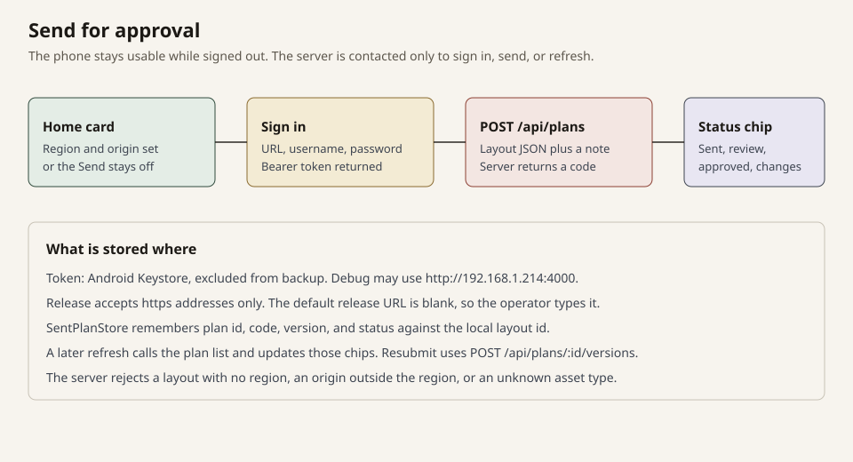

`AccountViewModel` is the only part of the phone that knows the server.

Send is offered on the Home card when the layout has a region and a geographic origin. The operator can attach a note. If they are signed out, the plan is held and sent as soon as sign-in succeeds.

`ServerClient` uses OkHttp:

- `POST /api/auth/token` with username and password
- `POST /api/plans` with the layout JSON for a first send
- `POST /api/plans/:id/versions` when the last status was changes-requested or rejected
- a plan list fetch to refresh chips

The bearer token is stored with the Android Keystore. Session files are excluded from backup. A 401 clears the session and asks the operator to sign in again. Other refresh failures keep the last known status.

`SentPlanStore` maps the local layout id to the server plan id, the human code, the version, and the status. The local JSON file is still the plan. The store is only the approval receipt.

Debug cleartext is allowed for the LAN dashboard. Release requires HTTPS.

### 2.8 Web dashboard

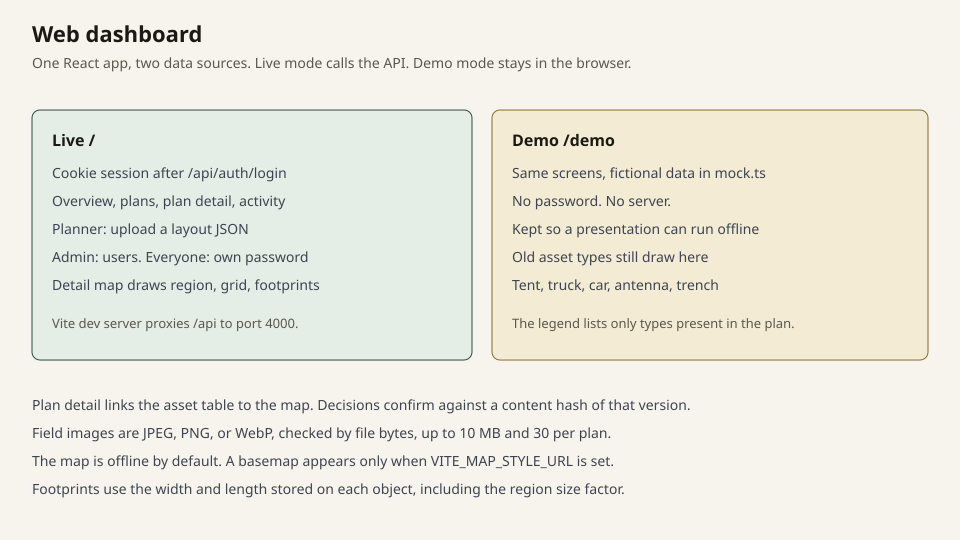

The dashboard is for someone who was not holding the phone. It shows the region, a metric grid, each asset footprint, the origin, a table of assets, version history, comments, field photos, and the decision panel.

Pages, behind sign-in:

| Page | Who |
|---|---|
| Overview | Status tiles, the queue that needs this person, recent activity. |
| Plans | Search and filters for status, planner, asset type, and dates. Filters stay in the URL. |
| Plan detail | Map, table, versions, comments, photos, decision. |
| New plan | Planner uploads a layout JSON. The phone can do this itself; the page remains for a file. |
| Activity | Append-only log. |
| Users | Admin only. |
| Account | Own password. |

The detail map can run with no tiles. Footprints, the region, and the grid are drawn from the layout numbers. A basemap is used only when `VITE_MAP_STYLE_URL` is set. Displayed sizes are rounded to the centimetre. The legend lists only types that appear in that plan. Counts use the right plural, including forms such as "1 K-131".

Field photos are ground images, separate from AR captures. JPEG, PNG, and WebP are accepted by sniffing the file bytes. Limit 10 MB and 30 images per plan. A random name is what gets stored on disk.

### 2.9 Audit

Every state-changing action appends a row whose hash includes the previous row's hash. The first previous hash is 64 zero digits. `GET /api/audit/verify`, for an admin or an auditor, walks the chain and reports a break if a row was edited or deleted. The check is meaningful when the database file itself is protected. The chain does not by itself stop someone who can rewrite every row and recompute the hashes.

---

## 3. Low-level design

### 3.1 Android packages

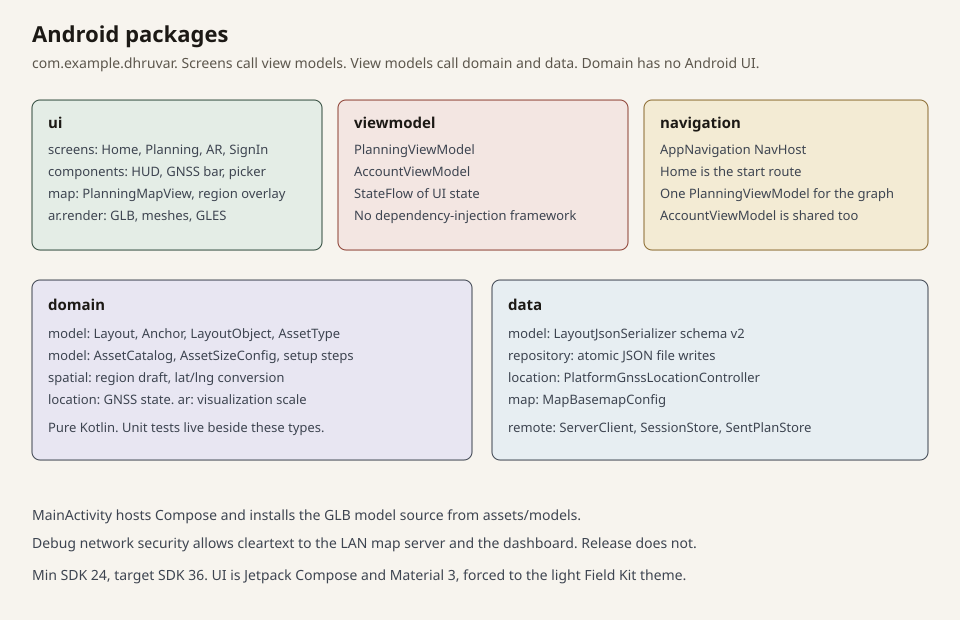

Package root: `com.example.dhruvar`.

| Package | Responsibility | Depends on |
|---|---|---|
| `ui.screens`, `ui.components`, `ui.map` | Compose. No file format and no HTTP. | view models, domain types |
| `ui.ar.render` | ARCore session drawing, `GlbParser`, `AssetModelRegistry`, `ARRenderer`, `ARObjectRenderer` | domain sizes and the current layout |
| `viewmodel` | `PlanningViewModel`, `AccountViewModel` | domain, data |
| `navigation` | Routes: `home`, `signIn`, `planning`, `ar`, `fieldGuide` | screens |
| `domain.model` | Layout, assets, setup steps | nothing Android |
| `domain.spatial` | Region draft, workspace geometry, coordinate conversion | domain model |
| `domain.location`, `domain.ar` | GNSS state, AR scale presets | nothing Android |
| `data.model` | `LayoutJsonSerializer` | domain model |
| `data.repository` | Load and save JSON | serializer |
| `data.location` | `PlatformGnssLocationController` | Android location APIs |
| `data.map` | Basemap URL and localhost rewrite | `BuildConfig` |
| `data.remote` | `ServerClient`, `ServerUrl`, `SessionStore`, `SentPlanStore` | OkHttp, Keystore |

`PlanningViewModel` is large because it owns setup, region edits, origin edits, object edits, save, and the messages shown in the HUD. New placement behaviour belongs next to `newSizedObject` and `setRegionSideMeters`, which are the two places that apply `AssetSizeConfig`.

Tests under `app/src/test` cover region geometry, asset sizes, GNSS status text, layout JSON, setup steps, object drag and rotation, and server URL checks. They run on the JVM and do not need a phone.

### 3.2 Layout record

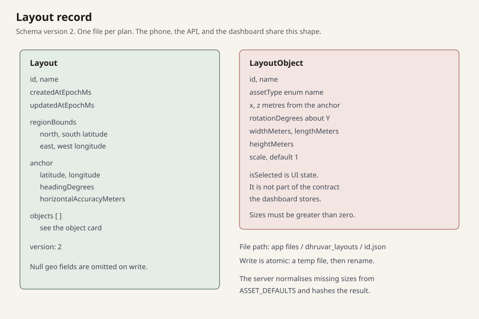

`LayoutJsonSerializer.CURRENT_SCHEMA_VERSION` is 2. The writer always emits `version: 2`. A reader treats a missing version as 1 and still loads the fields it understands.

`regionBounds` and the geographic keys on the anchor are omitted when null. A plan that has never left the first setup step can therefore be a small file.

Object ids are UUIDs. Names default to the display name plus a count, such as `Gunship 1`. `scale` defaults to 1 and is separate from the metre dimensions. The dashboard's normalised object does not keep `scale`; it keeps the three metre fields. The phone should treat `widthMeters`, `lengthMeters`, and `heightMeters` as the size that must survive a round trip.

`isSelected` is interface state. A fresh load selects nothing.

Server acceptance, in `server/src/layout.ts`, is stricter than the phone's local reader:

- region edges must form an area, north above south, west left of east, and must not cross the antimeridian
- the origin must lie inside that box
- at most 500 objects
- asset type must be one of the six current types or the five retired ones
- a missing size is filled from `ASSET_DEFAULTS`
- rotation is wrapped into 0–360
- the content hash is the first 16 hex characters of SHA-256 over the normalised JSON

A malformed upload is rejected with the first schema error. The server does not invent a repair.

### 3.3 Setup state machine

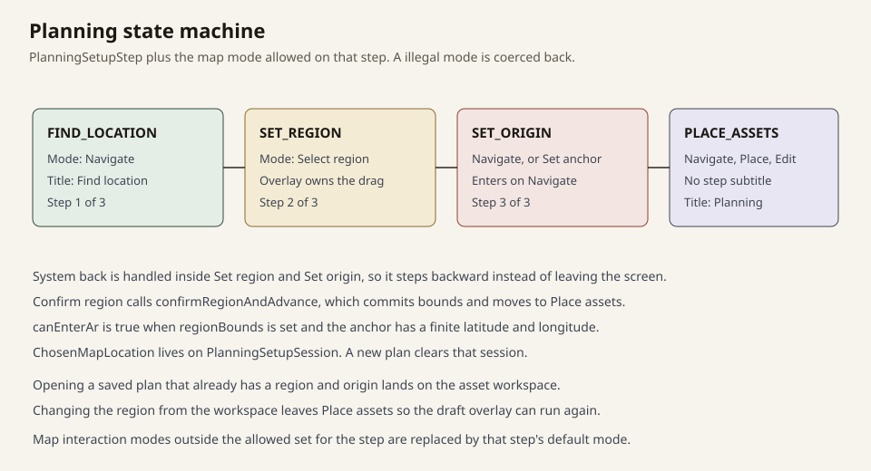

`PlanningSetupStep`:

| Step | Enters in mode | Also allows | Progress label |
|---|---|---|---|
| `FIND_LOCATION` | Navigate | Navigate only | Step 1 of 3 |
| `SET_REGION` | Select region | Select region only | Step 2 of 3 |
| `SET_ORIGIN` | Navigate | Navigate, Set anchor | Step 3 of 3 |
| `PLACE_ASSETS` | Navigate | Navigate, Place asset, Edit | none |

`coerceMapInteractionMode` replaces a mode the step does not allow with the step's default. That is what stops a leftover "place asset" mode from surviving a jump back to Find location.

`showsRegionDraftOverlay` is true only on Set region and only on the map surface. Changing the region from the workspace therefore leaves the workspace so the overlay can appear.

`handlesSystemBackInternally` is true for Set region and Set origin. The system back button steps backward. On the other steps it leaves Planning.

`canConfirmSetupRegion` is true for a draft that passes `rejectionReason`, or for an already committed box ("continue with current region"). `canContinueSetOrigin` requires `hasGeographicFix`. `canEnterAr` requires both the box and the fix. The message when AR is blocked is `Set region and origin before AR`.

`PlanningSetupSession.chosenLocation` is the only memory of the search hit. It is cleared in `createNewLayout`.

### 3.4 Sizing formula

Implemented by `AssetSpecification.scaledToLength` and `PlanningViewModel.newSizedObject`.

```
realSpec = modelProportions.scaledToLength(configuredLength)
k        = clamp(regionSideMetres / 150, 0.5, 3)
stored   = realSpec * k
```

`scaledToLength` divides the target length by `max(width, length)` and multiplies width, length, and height by that quotient.

`effectiveRegionSide` is the longer side of `regionBounds` when a region exists, otherwise the side chosen in the picker (`regionSideMeters`, default 250).

When the side changes from `old` to `new` and assets already exist:

```
ratio = regionSizeFactor(new) / regionSizeFactor(old)
each stored dimension *= ratio
```

Positions `x` and `z` are not multiplied. Only the footprint grows or shrinks.

### 3.5 Coordinate conversion

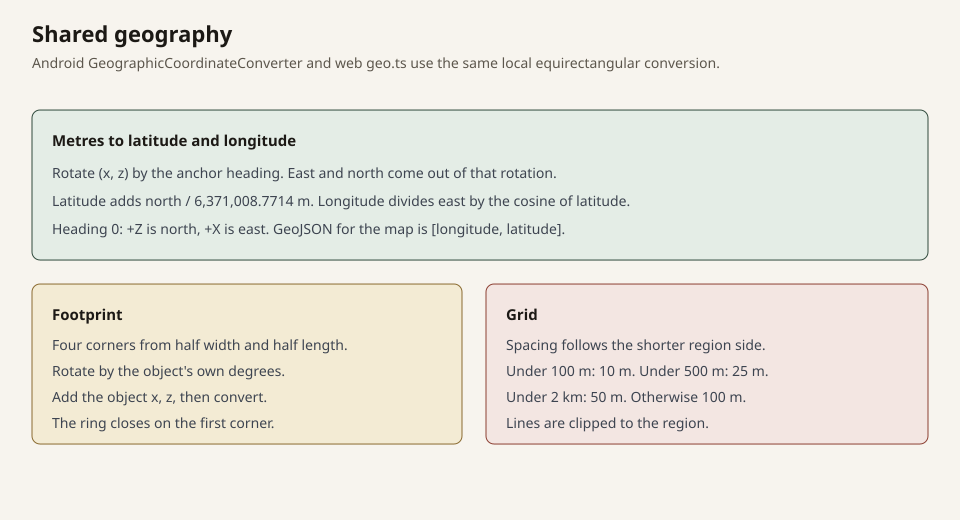

Earth radius used on both sides: `6_371_008.7714` metres.

Given anchor latitude φ, longitude λ, heading h, and object offsets x and z:

```
east  =  x cos h + z sin h
north = -x sin h + z cos h
φ' = φ + north / R          (then converted between radians and degrees)
λ' = λ + east / (R cos φ)
```

The web function `offsetToLatLng` returns GeoJSON order `[longitude, latitude]`.

A footprint takes the four corners at ±half-width and ±half-length, rotates them by the object's `rotationDegrees`, adds `(x, z)`, and runs each corner through the formula above. The ring repeats the first corner so the polygon closes.

Grid spacing uses the shorter region side: 10 m under 100 m, 25 m under 500 m, 50 m under 2 km, otherwise 100 m. If that would draw more than 40 lines along the long side, the step grows to `longest / 40`. Lines are in latitude and longitude and clipped to the box. The Android map and `web/src/geo.ts` follow this same rule so a reviewer sees the grid the operator planned against.

Region-side length on the phone uses `RegionDraftGeometry` (about 111_320 m per degree of latitude, longitude scaled by cosine). The dashboard uses haversine for the displayed "width × height" label. For the boxes this app draws, the two agree closely. They are not bit-identical.

### 3.6 AR render pipeline

Classes, in the order a frame uses them:

| Class | Job |
|---|---|
| `ARVisualizationScreen` | Compose host, calibration UI, scale controls, briefing chip. |
| `ARRenderer` | GL surface, ARCore frame, camera background. |
| `ARObjectRenderer` | One layout object: pose from origin plus `(x, height, z)`, then the mesh. |
| `AssetModelRegistry` | Cache of `Mesh3D` per `AssetType`. Placeholder until the GLB arrives. |
| `GlbParser` | Reads the GLB into parts: vertices, normals, UVs, indices, colour or texture. |
| `ArVisualizationScale` | `FULL` 1, `ONE_TO_20` 0.05, `ONE_TO_50` 0.02. |
| `ArAssetSize` | Per-model display factor, default 1, range 0.5–10. |

A part is one draw call. Textures upload to GL on first use. `Mesh3D.isPlaceholder` stays true while the real file is loading or if the read failed, and the box remains.

Mapping once the session origin exists:

| Planning | AR, relative to the session origin |
|---|---|
| +X | +X along the ground |
| +Z | +Z along the ground |
| height | +Y, the mesh already stands on Y = 0 |
| Full scale | 1 planning metre = 1 AR metre |

Miniature scale multiplies both the offset and the mesh. Model-size multiplies only the mesh.

### 3.7 Local persistence and build flags

| Data | Where |
|---|---|
| Layout JSON | App files `dhruvar_layouts/<id>.json` |
| Sent-plan receipt | App files, keyed by layout id |
| Session token and user | Keystore-backed `SessionStore` |
| AR photos | MediaStore `Pictures/DhruvAR/` |
| GLB | APK assets `models/*.glb` |

`BuildConfig` fields:

| Field | Debug | Release |
|---|---|---|
| `MAP_STYLE_URL` | public OpenFreeMap Liberty style, used when the map server base is empty | same |
| `MAP_SERVER_BASE` | `http://192.168.1.205:8088` | same default; cleartext depends on network security config |
| `DEFAULT_SERVER_URL` | `http://192.168.1.214:4000` | empty string |
| `PMTILES_URL` | empty | empty |

`ServerUrl.normalize` strips a trailing slash and, outside debug, refuses a non-HTTPS base. `ServerUrlTest` locks that rule.

Debug `network_security_config` permits cleartext for the LAN. Release does not include that file.

### 3.8 Server process

Node.js 22.13 or newer, Express 5, TypeScript, `node:sqlite`. No native database addon.

Startup in `server/src/index.ts`:

1. Trust proxy only when `TRUST_PROXY` is set.
2. Helmet content security policy. MapLibre needs inline styles, blob workers, and an optional map origin for images and connections.
3. JSON bodies up to 2 MB. Cookie parser.
4. `/api` routes set `Cache-Control: no-store`.
5. Auth, users, and plans routers.
6. If `web/dist` exists, the same process serves the built dashboard and falls through to `index.html` for client routes.

Configuration environment variables: `PORT` (4000), `DATA_DIR`, `COOKIE_SECURE`, `TRUST_PROXY`, `SESSION_IDLE_MINUTES`, `SESSION_ABSOLUTE_HOURS`, `MAX_UPLOAD_MB`, `MAX_IMAGES_PER_PLAN`, `LOGIN_MAX_FAILURES`, `LOGIN_LOCK_MINUTES`, `MAP_ORIGIN`, `WEB_DIST`.

### 3.9 Tables

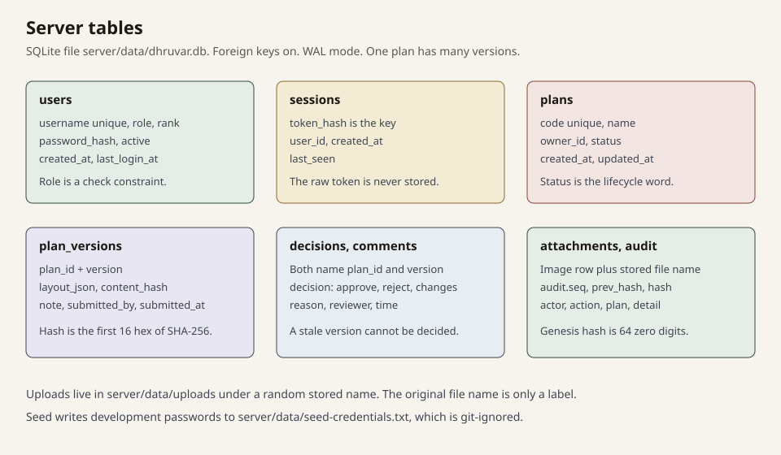

Database file: `server/data/dhruvar.db`. `PRAGMA foreign_keys = ON`, WAL, busy timeout 5 seconds.

| Table | Key | Holds |
|---|---|---|
| `users` | `id` | username (unique, case-insensitive), name, rank, role check, scrypt hash, active flag |
| `sessions` | `token_hash` | user, created, last seen |
| `plans` | `id`, unique `code` | name, owner, status, timestamps |
| `plan_versions` | `(plan_id, version)` | `layout_json`, `content_hash`, note, submitter, time |
| `decisions` | `id` | plan, version, reviewer, `approve` / `reject` / `changes`, reason, time |
| `comments` | `id` | plan, version, author, text, time |
| `attachments` | `id` | original file name, random `stored_name`, sniffed mime, size, caption, uploader |
| `audit` | `seq` autoincrement | time, actor, action, plan, detail, `prev_hash`, `hash` |

Image bytes are files in `server/data/uploads/<stored_name>`, not blobs in SQLite. Download is allowed only when `canViewPlan` is true for that plan, and the response sets `nosniff`.

Deleting a plan cascades to versions, decisions, comments, and attachment rows. Session rows cascade when the user row goes.

### 3.10 Rules module

`server/src/rules.ts` has no database import. Route handlers call it and then do the I/O. `rules.test.ts` covers the matrix.

Important functions:

| Function | True when |
|---|---|
| `canViewPlan` | the actor is not a planner, or the actor owns the plan |
| `canCreatePlan` | role is planner |
| `canStartReview` | reviewer, not the owner, status is SUBMITTED |
| `canDecide` | reviewer, not the owner, status is SUBMITTED or UNDER_REVIEW |
| `canWithdraw` | owning planner, status open |
| `canResubmit` | owning planner, status CHANGES_REQUESTED or REJECTED |
| `canComment` | any role except auditor, and they can view the plan |
| `canAttach` | owning planner or any reviewer, and the plan is not withdrawn |
| `reasonError` | changes and reject need at least 10 characters; approve may have an empty reason |

`STATUS_FOR` maps `approve` → APPROVED, `reject` → REJECTED, `changes` → CHANGES_REQUESTED.

`passwordError` requires length 10–200, upper, lower, digit, and refuses a password that contains the username when the username is at least 3 characters.

The web file `web/src/rules.ts` mirrors these checks so buttons match. It is not a second authority.

### 3.11 Authentication

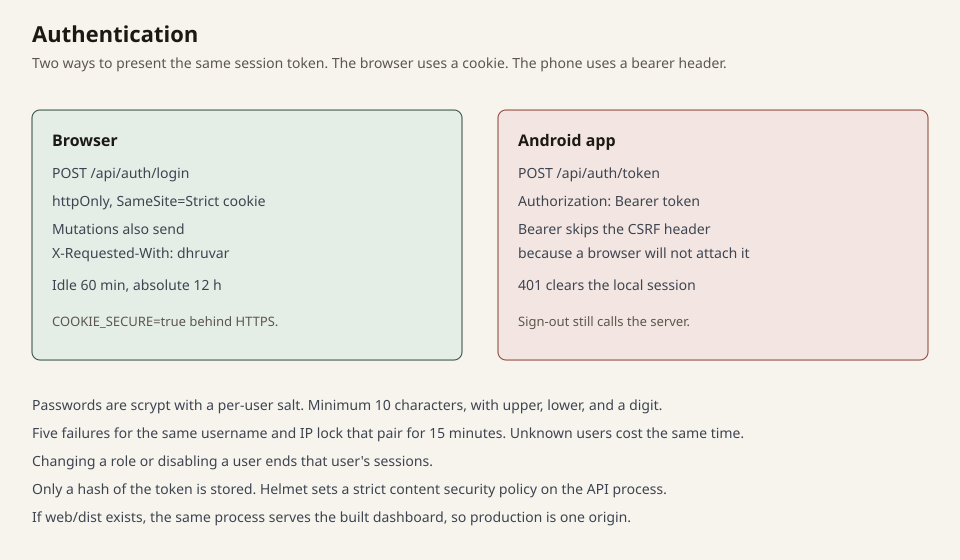

Login creates a random token, stores only its hash, and returns the raw token once.

| Client | Endpoint | How later requests authenticate |
|---|---|---|
| Browser | `POST /api/auth/login` | `httpOnly`, `SameSite=Strict` cookie. Mutations must also send header `X-Requested-With: dhruvar`. |
| Phone | `POST /api/auth/token` | `Authorization: Bearer`. The CSRF header is not required, because a normal browser will not attach that header by itself. |

`loadUser` accepts the bearer header ahead of the cookie. Idle timeout is 60 minutes and the absolute lifetime is 12 hours, unless the environment overrides them. Expired rows are purged when a request loads the user.

Five failures for one username and IP lock that pair for 15 minutes. The code path for an unknown username takes similar time to the path for a wrong password.

A role change or a disable ends that user's sessions. Logout deletes the session row. The phone still calls logout when it has a token, and clears local state even if that call fails.

Passwords use scrypt and a per-user salt.

### 3.12 HTTP API

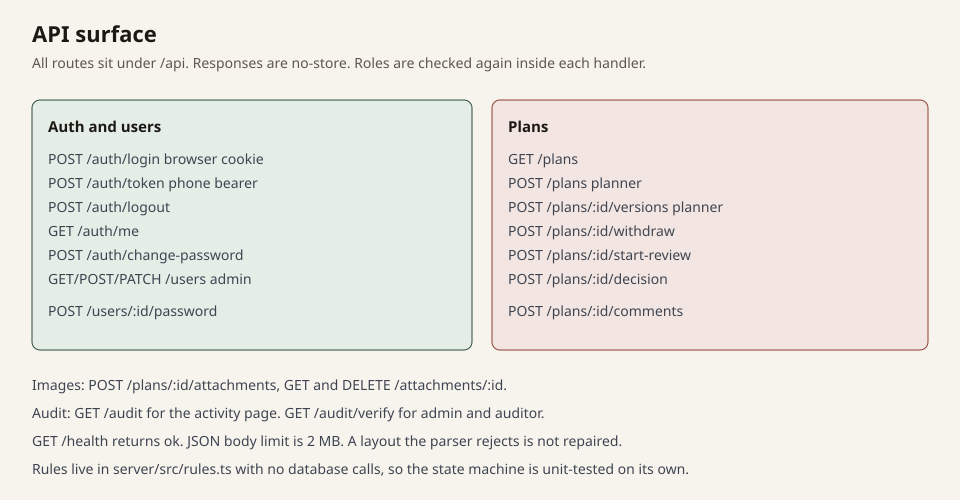

Prefix `/api`.

| Method and path | Who | Effect |
|---|---|---|
| `GET /health` | anyone | `{ ok: true }` |
| `POST /auth/login` | anonymous | cookie session |
| `POST /auth/token` | anonymous | JSON token for the phone |
| `POST /auth/logout` | signed in | deletes the session |
| `GET /auth/me` | signed in | current user |
| `POST /auth/change-password` | signed in | own password |
| `GET /users` | signed in | directory the UI may show |
| `GET /users`, `POST /users`, `PATCH /users/:id` | admin | create, role, disable |
| `POST /users/:id/password` | admin | reset |
| `GET /plans` | signed in | planner sees own rows; others see all |
| `POST /plans` | planner | body is layout JSON plus a note; creates version 1 |
| `POST /plans/:id/versions` | owning planner, and only if resubmit is allowed | next version |
| `POST /plans/:id/withdraw` | owning planner, while open | WITHDRAWN |
| `POST /plans/:id/start-review` | reviewer | UNDER_REVIEW |
| `POST /plans/:id/decision` | reviewer | approve, reject, or changes, bound to a version hash |
| `POST /plans/:id/comments` | anyone who `canComment` | comment on a version |
| `POST /plans/:id/attachments` | anyone who `canAttach` | multipart image |
| `GET /attachments/:id` | anyone who can view the plan | the bytes |
| `DELETE /attachments/:id` | uploader or admin | removes the row and the file |
| `GET /audit` | signed in, read scope follows the role | activity list |
| `GET /audit/verify` | admin, auditor | chain check |

The phone's submit body is the serializer output. The server's fixture `server/scripts/fixtures/app-layout-v2.json` is a file produced by that serializer, and `api-test.ts` posts it, including extra anchor fields the dashboard does not display (`id`, `label`, `x`, `z`).

### 3.13 Audit row

```
hash = SHA-256( JSON([ prevHash, at, actorId, action, planId, detail ]) )
```

`audit()` reads the latest hash inside the same transaction as the change it records. `verifyAuditChain` recomputes each row from its stored fields and checks `prev_hash` against the previous row. A gap, an edit, or a deleted middle row fails the walk.

### 3.14 Web application

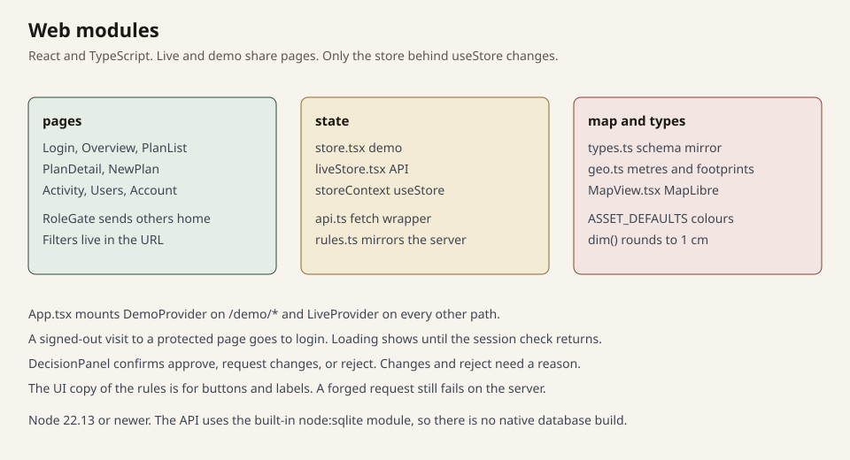

Vite + React + TypeScript. Development: the web app on port 5173 proxies `/api` to port 4000.

`App.tsx` is the split:

- `/demo/*` → `DemoProvider` (`store.tsx` + `data/mock.ts`)
- everything else → `LiveProvider` (`liveStore.tsx` + `api.ts`)

Both providers satisfy `useStore()`. Pages do not import the API directly.

`Protected` waits until the session check finishes, then redirects to login. `RoleGate` wraps New plan (planner) and Users (admin). Anyone else hitting those URLs is sent to the overview.

`types.ts` is the TypeScript twin of schema v2, plus the dashboard's own types: `Role`, `Plan`, `PlanVersion`, `Decision`, `Comment`, `Attachment`. Asset type is a union of the six current names and the five retired names.

`MapView.tsx` builds GeoJSON:

- a polygon for the region
- line features for the grid
- a polygon ring per object from `footprintRing`
- a point for the origin

Colours and labels come from `ASSET_DEFAULTS` in `geo.ts`. `assetCountText` keeps capitals for names that contain a digit or two consecutive capitals, so the label stays "K-131" rather than "k-131".

`dim` rounds a metre value to the nearest centimetre and drops trailing zeros. A stored length of `27.037` displays as `27.04`.

### 3.15 Phone client sequence for a first send

1. Home checks `regionBounds != null` and `anchor.hasGeographicFix`.
2. If `SessionStore.token()` is null, navigate to Sign in and keep `(layout, note)` in `pendingSend`.
3. `ServerUrl.normalize` accepts the typed base. Debug allows `http`. Release requires `https`.
4. `POST /api/auth/token`. On success, save the base URL and the token, then `refreshStatuses()`.
5. `LayoutJsonSerializer.serialize(layout)`.
6. `POST /api/plans`. The response gives `planId` and `code`.
7. `SentPlanStore.put(layoutId, SentPlan(planId, code, version 1, SUBMITTED, now))`.
8. The card shows the code and "Sent".

A later open of Home calls `refreshStatuses()`, which overlays server status onto those receipts. Plans the server does not return keep their last local status.

### 3.16 Error handling

| Place | Behaviour |
|---|---|
| Region draft too small or too large | Confirm stays on the step. The HUD shows the rejection string. |
| Origin outside the box | The stamp or the tap does not write the anchor. |
| Shrink strands an asset | The side change is ignored and a feedback line is set. |
| GLB still loading | The footprint box is drawn. The frame is not blocked on the 57 MB parse. |
| GLB missing | The placeholder remains and the type is marked failed. |
| Server unreachable | `ServerException` status 0. Send shows the message. A status refresh stays quiet and keeps the last chip. |
| HTTP 401 | Local session cleared. "Your session expired. Sign in again." |
| Layout rejected by zod | The API returns the first path and message. The phone shows that text. The local file is untouched. |

---

## 4. How the three views stay aligned

```text
AssetSizeConfig.length
        │
        ▼
AssetSpecification.scaledToLength
        │
        ▼
newSizedObject × regionSizeFactor
        │
        ▼
LayoutObject width, length, height, x, z, rotation
        │
        ├─ Planning map footprint and hit test
        ├─ AR mesh scale about the session origin
        └─ JSON file
                │
                ▼
           POST /api/plans
                │
                ▼
           plan_versions.layout_json
                │
                ▼
           web geo.ts footprintRing
```

If a size looks wrong in only one place, the bug is in that view. If it looks wrong in all three, the stored metres are already scaled, usually by the region factor.

---

## 5. Build and run, as the design expects

**Phone**

```bash
./gradlew :app:assembleDebug
```

An ARCore-capable device is required for the AR screen. Planning runs without it. The debug app will look for the map server at `192.168.1.205:8088` and will offer the dashboard at `192.168.1.214:4000`.

**API and dashboard**

```bash
cd server && npm install && npm run seed && npm run dev
cd web && npm install && npm run dev
```

Seed passwords are written to `server/data/seed-credentials.txt`. `npm test` runs the pure rules. `npm run test:api` runs the HTTP tests against a throwaway database.

---

## 6. Boundaries of this design

These are present in the code's own limits, and they belong in the design so a later change does not pretend they already exist.

- Positions are a prototype GNSS fix plus a local metre frame. The stored accuracy is the number the receiver reported.
- The default region draws assets larger than the published real length, by design of the region factor.
- AR calibration is per session. The phone does not persist the ARCore anchor.
- The audit chain detects tampering of individual rows. It assumes the database file is otherwise protected.
- Identity is username and password. There is no organisation directory and no second factor.
- The two K-131 models dominate the APK size.
- Unit and cluster grouping, version-to-version visual diff, PDF export, and push notifications are not in the current modules.

The root `README.md` and `docs/session-progress.md` still describe the older tent-and-truck library and an earlier map-server port. This document follows the code: six assets, region sizing, GNSS detect, GLB drawing, and send-for-approval.
